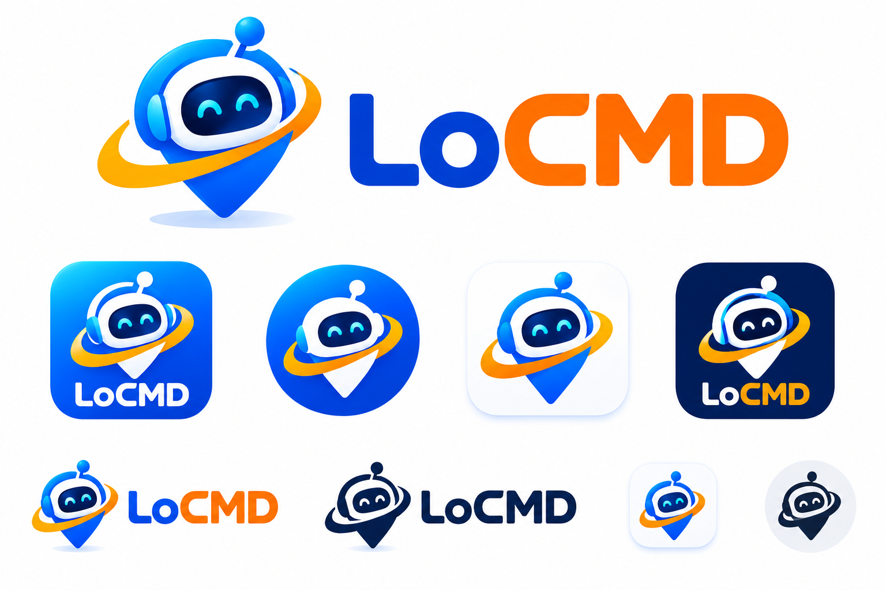

# LocMd

LocMd 是一款面向本地大语言模型的桌面应用，支持模型管理与对话、智能体任务处理，以及图片和视频生成。

## 主要功能

- 管理、运行本地模型并进行对话。
- 使用智能体完成任务，并在选定的工作文件夹中读取、创建和写入文件。
- 支持本地图片与视频生成；云端生成需手动切换并配置接口。使用云端服务时，提示词和所选参考图片会发送给服务提供方，且可能产生费用。
- 查看系统资源使用情况，并按需调整应用设置。

## 品牌图稿

以下为两版品牌图稿：

## 开源协议

本项目基于 [MIT 许可证](LICENSE) 开源。

项目地址：[GitHub 仓库](https://github.com/sincalforge/locmd)
